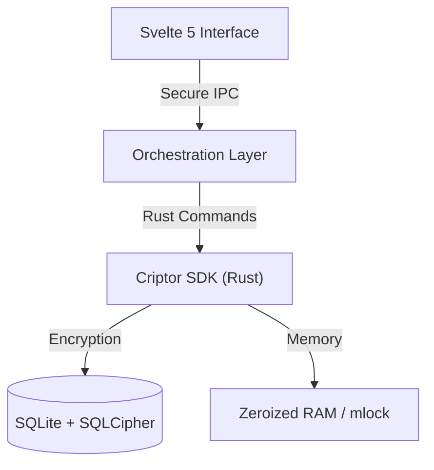

# Cript — Credential Manager


Cript means **Security through Isolation**. We prioritize network-isolated security and practice digital transparency.


---

## Architecture Overview

1. **Process Isolation:** Interface and motor decoupled, with regular audits.
2. **Digital Sovereignty:** There is no "cloud by default." Your data belongs to you, resides exclusively on your system, and you are solely responsible for it.
3. **Forensic Resistance:** Measures are implemented so that even if an attacker gains physical access to RAM or system dumps, they will find no readable traces of your information.

---

## Features

- **Credential vault:** Store sites, usernames, passwords, recovery codes and notes. Includes an integrated password generator with a strength meter and clipboard auto-clear.
- **PINs:** Keep bank cards, access codes and application PINs in the same encrypted vault.
- **Encrypted notes:** Rich-text board editor plus attachment import (`.docx`, `.pdf`, `.xlsx`, `.txt`, `.md`).
- **Groups / Organizer:** Classify accounts and PINs into color-coded groups.
- **Import / Export:** Move data with native, password-protected `.crp.pack` packages or import from external CSV files (e.g. Chrome).
- **Two-factor authentication:** TOTP (RFC 6238) with QR setup, verification and single-use recovery codes.
- **Session hardening:** Idle auto-lock, remote-connection detection and manual vault lock.
- **Customization:** Accent themes, light/dark/system mode, custom backgrounds and English/Spanish UI.
- **Built-in terminal:** Query the vault from an integrated command interface.
- **Self-updater:** Desktop auto-update support.

---

## Criptor Engine (SDK)

The cryptographic engine lives in a standalone, framework-agnostic SDK named **`criptor`**
([github.com/aaronlomas/criptor](https://github.com/aaronlomas/criptor)), consumed by this
application as a git dependency. It is responsible for protecting sensitive data:

### Cryptography
- **Storage:** **SQLite + SQLCipher** using **AES-256-CBC** with **HMAC-SHA512** page integrity (encrypt-then-MAC); the cipher key is derived with **PBKDF2-HMAC-SHA512** (256,000 iterations). We protect not only the entries but also the schema, indexes, and metadata.
- **Secrets:** Each individual entry is additionally encrypted using **ChaCha20-Poly1305**, providing Authenticated Encryption with Associated Data (AEAD).
- **Brute-Force Protection:** We implement **Argon2id** (Parameters: 64MB RAM, 3 iterations, 4 threads), the Password Hashing Competition standard, configured to be costly on specialized hardware (ASIC/GPU).

### Memory Management
- **Zeroization:** RAM is physically overwritten with zeros as soon as a secret is no longer needed, mitigating memory reuse attacks.
- **Non-Swappable RAM:** We implement `mlock` / `VirtualLock` to prevent master keys from ending up in the operating system's swap file on the hard drive.
- **Process Hardening:** Core dumps are disabled, and process inspection is blocked using OS-level security policies.

---

## Layered Architecture



- **`criptor`** ([SDK](https://github.com/aaronlomas/criptor)): The cryptographic engine of Cript, consumed as a git dependency.
- **`src-tauri`**: Manages permissions and communication between the webview and the system.
- **`src`**: our user interface.

---

## Installation on Debian/Ubuntu

**Commands:**

1. **Download the public GPG key:**
  `curl -fsSL https://aaronlomas.github.io/cript/cript-archive-keyring.gpg | sudo gpg --dearmor -o /usr/share/keyrings/cript-archive-keyring.gpg`

2. **Add the repository to APT sources:**
  `echo "deb [arch=amd64 signed-by=/usr/share/keyrings/cript-archive-keyring.gpg] https://aaronlomas.github.io/cript stable main" | sudo tee /etc/apt/sources.list.d/cript.list > /dev/null`

3. **Synchronize and install Cript:**
  `sudo apt update && sudo apt install cript`

## Installation on Windows

**Download the .exe or .msi binary from our releases**

More details on our website -> <a href="https://cript-web.vercel.app/">Cript Web</a>

---

## Development Setup

**Prerequisites:**
- [Node.js](https://nodejs.org/) (v20+)
- [pnpm](https://pnpm.io/) (v9+) — **required**; `npm install` is blocked on purpose
- [Rust](https://rustup.rs/) (v1.77+)
- [Tauri Prerequisites](https://tauri.app/start/prerequisites/)

```bash
# Install dependencies
pnpm install

# Run in development mode
pnpm tauri dev

# Build production binary
pnpm tauri build

# Type-check the interface
pnpm check

# Run the component workshop
pnpm storybook
```

## Audit and Quality

```bash
# Full security audit (Rust + JS)
pnpm security
```

Or individually:
- `cargo audit`: Checks for vulnerabilities in Rust dependencies.
- `cargo clippy`: Strict linter to ensure idiomatic and secure code.
- `pnpm audit`: Checks the Node.js ecosystem.

---

## License

Cript is free software under the **GPL-3.0** license.

## Project Documents

| Document | Description |
| :--- | :--- |
| [SECURITY.md](./SECURITY.md) | Security policy and vulnerability reporting |
| [PRIVACY.md](./PRIVACY.md) | Privacy policy |
| [TERMS.md](./TERMS.md) | Terms of use |
| [AGENTS.md](./AGENTS.md) | Development rules and conventions |

## Our Website

<a href="https://cript-web.vercel.app/">Cript Web</a>
